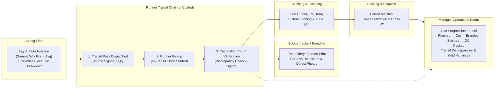

# FPCC Cortex
### *Frontier DIY Operations Suite & Runner Telemetry for Apparel & Custom Merchandise Manufacturing*

[](https://github.com/ppl-amehta/fpcc-cortex/actions)
[](https://opensource.org/licenses/MIT)
[](https://nodejs.org/)
[](https://sqlite.org/)

---

## Overview

**FPCC Cortex** is an apex-frontier, resource-efficient business operations management suite engineered specifically for high-mix custom merchandise, hosiery, and apparel manufacturing (t-shirts, polos, hoodies, sportswear, corporate merchandise).

Inspired by the **Rippling Operations Graph**, it unifies every manufacturing domain—from gate inwarding and dye lot tracking to cutting lay telemetry, runner material movements, subcontractor branding, line finishing, 100% QC, and carton packing—into a single live operational pulse.



---

## Core Operational Modules

### 1. Runner Logistics & Material Movement (`material_transits`)
Eliminates untracked material handovers between factory departments and external vendors with a strict chain of custody:
- **1. Dispatch**: Source department (e.g. Cutting) generates a Transit Pass (`TRN-YYMMDD-NN`) with piece count and assigns a runner.
- **2. Pickup**: Runner acknowledges physical pickup on the shop floor tablet (`IN_TRANSIT` status).
- **3. Verification**: Destination receiver (e.g. Stitching supervisor) counts the pieces upon delivery.
  - **Match**: Instant green verification (`DELIVERED_VERIFIED`).
  - **Discrepancy**: If pieces are missing/damaged, raises an immediate **Red Alert**, requires a mandatory explanation, and alerts the Operations Manager.

### 2. Cutting Floor & Master Palla Average (`cutting_jobs`)
- Computes **Marker Palla Average** from sample cuts:
  $$\text{Palla Average} = \frac{\text{Sample Palla Weight (kg)}}{\text{Sample Pieces}}$$
- Strict size-wise cut counts (XS, S, M, L, XL, 2XL) with automatic fabric balance checking.
- Real-time **Fabric Yield Comparison**: Compares actual lay consumption against planned BOM target with visual gain/loss badges.

### 3. Subcontractor & Branding Challans (`subcontractor_challans`)
- Issues formal gate passes for Screen Printing, Embroidery, DTF, and Heatseal.
- Return receipts track good panels, vendor defect categories (*Needle Cut*, *Print Smudge*, *Burning*), rework pieces, and photo references.

### 4. Stitching & Finishing Line Telemetry (`floor_process_logs`)
- Touch-optimized daily logging for:
  - Assembly Line Stitching
  - Thread Cutting (T/C)
  - Kaaj (Buttonhole punching)
  - Button attachment
  - Ironing & Steam Press
  - 100% Final QC Inspection (logs Pass vs. Reject with defect taxonomy).

### 5. Carton Packing Manifest (`carton_packings`)
- Balances size breakdown per master box with gross weight in kg.
- Generates carton tracking code (`BOX-YYMMDD-NN`) and dispatches to shipping bay.

### 6. Raw Material Inward & Perpetual Double-Entry Stock Ledger
- **Multi-Component Dye Lots (`DDMMYY-A`)**: Enforces matching shades across Body Fabric, Collar, Cuff, and Rib.
- **Fractional Roll Sequencing (`01/N` to `N/N`)**: Individual roll tracking with 3-decimal kg precision.
- **Perpetual Ledger**: Strict immutable audit log for every `INWARD`, `ISSUE_PRODUCTION`, and `RETURN_PRODUCTION`.

---

## Quickstart

### Option A: Local Run
```bash
# 1. Install dependencies
cd server && npm install

# 2. Ingest master data & seed operations
cd ..
python3 scripts/ingest_excel.py
python3 scripts/seed_operations.py

# 3. Start operations server
cd server && npm start
# Available at http://localhost:3000
```

### Option B: Docker Container
```bash
docker-compose up --build -d
# Available at http://localhost:3000
```

### Option C: Temporary Public Access (Cloudflare Tunnel)
```bash
cloudflared tunnel --url http://localhost:3000
```

---

## Testing & Verification Suite
Run the full integration test covering Cutting, Runner Transits, Discrepancies, Stitching, and Packing:
```bash
python3 scripts/test_operations_flow.py
```

---

## License
MIT License. Open and self-hostable.
